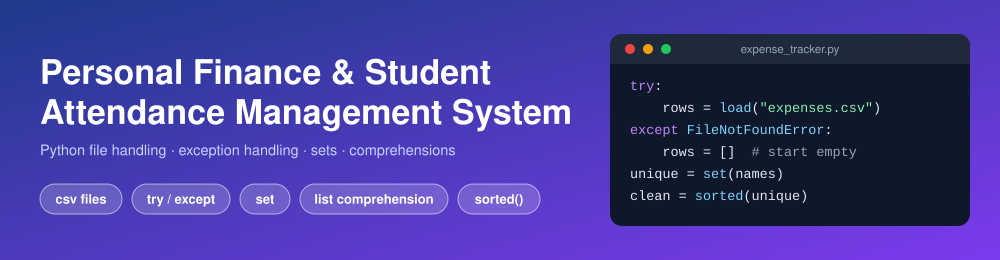
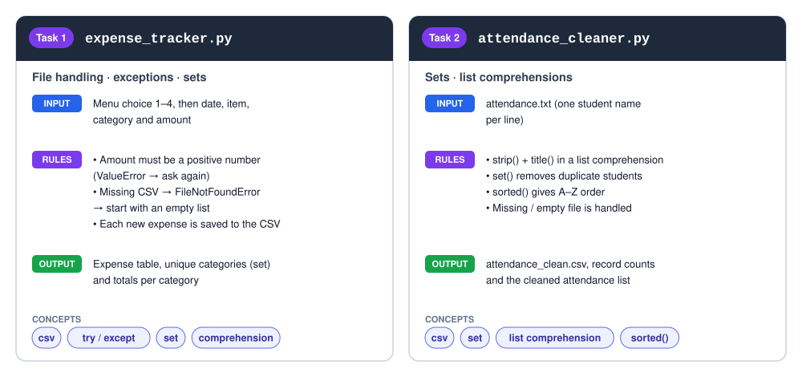
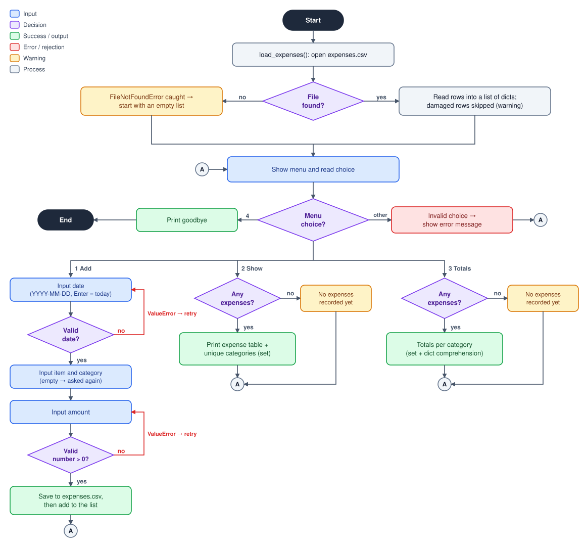
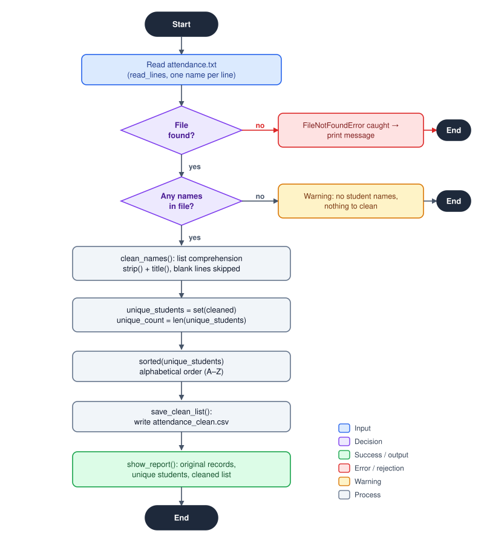
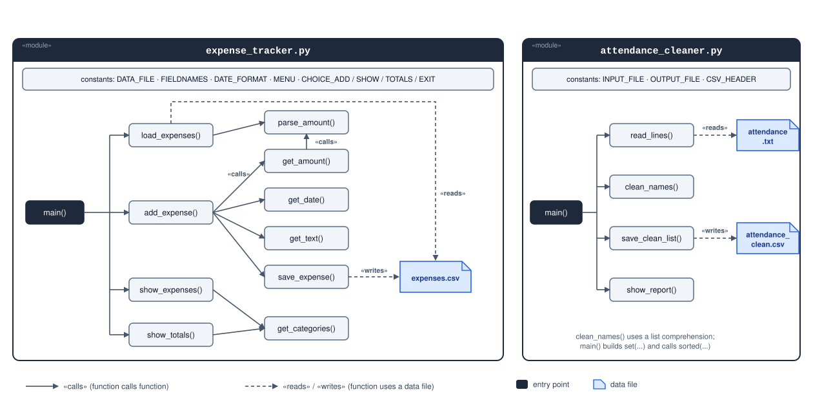

<p align="center"></p>

## 1. Project Overview

**Personal Finance & Student Attendance Management System.** Two small management tools for a training institute (expense tracking and attendance cleaning), built with Python file handling, exception handling, sets and comprehensions. Both use only the standard library.

| Task | File | Purpose | Topics |
|---|---|---|---|
| 1 | `expense_tracker.py` | Record daily expenses in `expenses.csv`, reload them on the next run, list them and total them by category | File handling, `FileNotFoundError`, `ValueError`, set |
| 2 | `attendance_cleaner.py` | Clean `attendance.txt`, remove duplicate students, sort A-Z and save `attendance_clean.csv` | List comprehension, set, `sorted()`, file handling |

<p align="center"></p>

## 2. Folder Structure

```text
python-files-errors-assessment/
├── assets/
│   ├── attendance_cleaner_flow.svg
│   ├── banner.svg
│   ├── expense_tracker_flow.svg
│   ├── overview.svg
│   └── uml_diagram.svg
├── README.md
├── attendance.txt
├── attendance_cleaner.py
└── expense_tracker.py
```

`assets/` holds the diagrams used by this README. The four files required by the brief are in the repository root. `expenses.csv` and `attendance_clean.csv` are created automatically when the programs run.

## 3. Task 1: Institute Expense Tracker (`expense_tracker.py`)

### Summary
A menu-driven program that keeps the institute's daily expenses (stationery, internet, refreshments, transport and more). Every new expense is appended to `expenses.csv` straight away, and the file is loaded again when the program starts, so nothing is lost between runs.

### Rules or requirements
- Save expenses in `expenses.csv` with the columns `date,item,category,amount`.
- Load saved expenses at start-up; catch `FileNotFoundError` and start with an empty list.
- Menu: 1 Add New Expense, 2 Show All Expenses, 3 Calculate Total Expenses by Category, 4 Exit.
- Ask for date, item, category and amount; catch `ValueError` for a bad amount and ask again.
- Use a **set** to show the unique categories.
- Save newly added expenses to the CSV file.

### Program Flow
<p align="center"></p>

### Code Methods Description
| Method / section | Purpose |
|---|---|
| Constants (`DATA_FILE`, `FIELDNAMES`, `DATE_FORMAT`, `MENU`, `CHOICE_*`) | Hold the file name, CSV columns, date format and menu text so there are no magic values in the code |
| `load_expenses()` | Reads `expenses.csv` into a list of dicts; catches `FileNotFoundError`; skips damaged rows and warns |
| `save_expense(expense)` | Appends one row to the CSV and writes the header only once |
| `parse_amount(text)` | Converts text to a positive, finite number or raises `ValueError` |
| `get_text(prompt)` | Repeats the question until the answer is not empty |
| `get_date(prompt)` | Accepts `YYYY-MM-DD`; Enter uses today's date; catches `ValueError` from `strptime` |
| `get_amount(prompt)` | Repeats the question until `parse_amount()` succeeds (catches `ValueError`) |
| `add_expense(expenses)` | Collects the four fields, saves to the CSV, then adds the expense to the list |
| `get_categories(expenses)` | Returns the unique categories as a **set** (set comprehension) |
| `show_expenses(expenses)` | Prints the table and the unique categories |
| `show_totals(expenses)` | Builds a dict of totals per category (dict comprehension) and the grand total |
| `main()` | Loads data, shows the menu in a loop and calls the matching function |

### Input Validation
| Problem | Handled by | Why |
|---|---|---|
| `expenses.csv` does not exist (first run) | `except FileNotFoundError` in `load_expenses()` | A new institute has no history yet; the program must start normally with an empty list |
| Amount is not a number, empty, `0`, negative, `nan`, `inf`, `1,500` | `except ValueError` in `get_amount()` (`parse_amount()` raises it) | Text cannot be added up, and a wrong total would damage the records; the user is asked again |
| Date is not a real `YYYY-MM-DD` date | `except ValueError` in `get_date()` | Keeps dates consistent in the CSV |
| Item or category is empty | Loop in `get_text()` | Every record needs a name and a category for the totals |
| Menu choice is not 1-4 | `else` branch in `main()` | The user gets a clear message instead of a crash |
| Damaged row in the CSV (wrong amount, missing field) | `except (KeyError, TypeError, ValueError)` in `load_expenses()` | One bad row must not stop the whole file from loading; a warning shows how many were skipped |
| CSV cannot be read or written (permission, folder in the way) | `except OSError` in `load_expenses()` and `add_expense()` | The user sees a message; an expense is only kept in memory after it was saved |
| Ctrl+C or Ctrl+D | `except (KeyboardInterrupt, EOFError)` around `main()` | Clean exit; saved data is already safe |

### Expected Results
- First run: message that no file exists, then an empty menu that works.
- Each added expense appears in `expenses.csv` immediately (amount written with 2 decimals).
- Option 2 prints a numbered table and the unique categories (for example `Internet, Stationery`).
- Option 3 prints one total per category and a grand total.
- On the next run the saved expenses are loaded and shown again.

## 4. Task 2: Student Attendance Cleaner (`attendance_cleaner.py`)

### Summary
Reads raw student names from `attendance.txt` (one per line), fixes spaces and capitalisation, removes duplicate students with a set, sorts the names A-Z and saves them to `attendance_clean.csv`. It then prints the original record count, the unique student count and the cleaned list.

### Rules or requirements
- Read names from `attendance.txt` (one name per line).
- Clean names with `strip()` and `title()` in a **list comprehension**.
- Use a **set** to find unique students and count them.
- Sort the cleaned names alphabetically.
- Save the cleaned, sorted list to `attendance_clean.csv`.
- Show the original record count, unique student count and cleaned list.

### Program Flow
<p align="center"></p>

### Code Methods Description
| Method / section | Purpose |
|---|---|
| Constants (`INPUT_FILE`, `OUTPUT_FILE`, `CSV_HEADER`) | File locations (next to the script) and the CSV header |
| `read_lines()` | Reads the file; catches `FileNotFoundError`, `OSError` and `UnicodeDecodeError`; returns `None` on failure |
| `clean_names(lines)` | List comprehension: `strip()`, fixes inner spaces, `title()`; skips blank lines |
| `save_clean_list(names)` | Writes the header and one name per row to `attendance_clean.csv`; catches `OSError` |
| `show_report()` | Prints original records, unique students, duplicates removed and the numbered list |
| `main()` | Runs the steps in order: read, clean, `set()`, `sorted()`, save, report |

### Input Validation
| Problem | Handled by | Why |
|---|---|---|
| `attendance.txt` is missing | `except FileNotFoundError` in `read_lines()` | The user is told which file is missing and where to put it, instead of seeing a traceback |
| File cannot be read or has invalid text | `except (OSError, UnicodeDecodeError)` | Permission or encoding problems get a clear message |
| Empty file or only blank lines | `if not cleaned` in `main()` | Nothing to clean, so no empty CSV is written |
| Blank lines between names | `if line.strip()` inside the comprehension | A blank line is not a student; the count of ignored lines is shown |
| Extra spaces, mixed capitals, BOM, Windows line endings | `strip()`, `split()`/`join()`, `title()`, `utf-8-sig` | `ali raza`, `ALI RAZA` and ` Ali  Raza ` become one student |
| Output file cannot be written | `except OSError` in `save_clean_list()` | The user sees a message and no false success is printed |

### Expected Results
- Names such as `  ali raza`, `ALI RAZA` and `Ali Raza` all become `Ali Raza` and are counted once.
- With the provided file: 15 original records, 9 unique students, 6 duplicates removed.
- `attendance_clean.csv` holds the header `student_name` and the 9 names in A-Z order.

## 5. UML Diagram

Type chosen: **module diagram**, because the code is procedural (constants and functions in two files, no classes). Solid arrows show `«calls»`; dashed arrows show which functions read or write a data file.

<p align="center"></p>

## 6. Concepts and Techniques Used

- **File handling**: `open()` with `with`, `csv.DictReader`, `csv.DictWriter`, `csv.writer`, append mode (`"a"`) and write mode (`"w"`), `newline=""`, UTF-8 encoding.
- **Exception handling**: `FileNotFoundError`, `ValueError`, `OSError`, `UnicodeDecodeError`, `KeyError`, `TypeError`, `KeyboardInterrupt`, `EOFError`.
- **Sets**: `get_categories()` returns `{e["category"] for e in expenses}` so each category appears once; `set(cleaned)` in the attendance cleaner removes duplicate students and `len()` gives the unique count.
- **List comprehension**: `[" ".join(line.strip().split()).title() for line in lines if line.strip()]` cleans every name in one expression.
- **Dictionary comprehension**: `show_totals()` builds `{category: sum(...) for category in ...}` for the totals.
- **Sorting**: `sorted()` on a set gives a stable A-Z list (also used to display categories in a fixed order).
- **Clean code**: constants instead of magic numbers, small functions, docstrings, input validation with clear messages, `if __name__ == "__main__":`.

## 7. How to Run

**Requirements:** Python 3.8 or newer (tested with Python 3.12). No extra packages.

```bash
git clone https://github.com/hiraaslam-data/python-files-errors-assessment.git
cd python-files-errors-assessment
```

Task 1: Expense Tracker
```bash
python expense_tracker.py
```

Task 2: Attendance Cleaner (needs `attendance.txt` in the same folder)
```bash
python attendance_cleaner.py
```

Alternative commands: use `python3 expense_tracker.py` / `python3 attendance_cleaner.py` on macOS or Linux, or `py expense_tracker.py` / `py attendance_cleaner.py` on Windows.

## 8. Sample Execution

### Task 1: Expenses are saved and loaded again

**Run 1** (new start, one invalid amount `abc` is rejected, two expenses are added):

```text
No saved file found (expenses.csv). Starting with an empty expense list.

===== Institute Expense Tracker =====
1. Add New Expense
2. Show All Expenses
3. Calculate Total Expenses by Category
4. Exit
Enter your choice (1-4): 1

--- Add New Expense ---
Date (YYYY-MM-DD, Enter for today): 2026-11-17
Item name: A4 paper ream
Category (e.g. Stationery, Internet): stationery
Amount: abc
Invalid amount. Please enter a positive number (for example 1500 or 249.50).
Amount: 1250.50
Expense saved to expenses.csv.

===== Institute Expense Tracker =====
1. Add New Expense
2. Show All Expenses
3. Calculate Total Expenses by Category
4. Exit
Enter your choice (1-4): 1

--- Add New Expense ---
Date (YYYY-MM-DD, Enter for today): 2026-11-18
Item name: Internet bill
Category (e.g. Stationery, Internet): Internet
Amount: 4999
Expense saved to expenses.csv.

===== Institute Expense Tracker =====
1. Add New Expense
2. Show All Expenses
3. Calculate Total Expenses by Category
4. Exit
Enter your choice (1-4): 4
Goodbye! All expenses are saved in expenses.csv
```

Content of `expenses.csv` after Run 1:

```text
date,item,category,amount
2026-11-17,A4 paper ream,Stationery,1250.50
2026-11-18,Internet bill,Internet,4999.00
```

**Run 2** (program started again; the saved expenses are loaded and used):

```text
Loaded 2 expense(s) from expenses.csv.

===== Institute Expense Tracker =====
1. Add New Expense
2. Show All Expenses
3. Calculate Total Expenses by Category
4. Exit
Enter your choice (1-4): 2

--- All Expenses ---
 No  Date        Item           Category        Amount
------------------------------------------------------
  1  2026-11-17  A4 paper ream  Stationery    1,250.50
  2  2026-11-18  Internet bill  Internet      4,999.00

Unique categories (2): Internet, Stationery

===== Institute Expense Tracker =====
1. Add New Expense
2. Show All Expenses
3. Calculate Total Expenses by Category
4. Exit
Enter your choice (1-4): 3

--- Total Expenses by Category ---
Internet                 4,999.00
Stationery               1,250.50
---------------------------------
Grand total              6,249.50

===== Institute Expense Tracker =====
1. Add New Expense
2. Show All Expenses
3. Calculate Total Expenses by Category
4. Exit
Enter your choice (1-4): 4
Goodbye! All expenses are saved in expenses.csv
```

### Task 2: Clean attendance (success)

`attendance.txt` (input, 15 lines):

```text
··ali·raza
SARA·KHAN··
Sara·Khan
ahmed·malik
Fatima·Noor
fatima···noor
·hassan·ali
ALI·RAZA
zainab·shah
Ahmed·Malik
bilal·ahmad
Hassan·Ali·
umar·farooq
ZAINAB·SHAH
ayesha·siddiqui
```
(`·` marks a space so the extra spaces are visible; the real file contains normal spaces.)

Run:

```text
===== Attendance Cleaning Report =====
Original records   : 15
Unique students    : 9
Duplicates removed : 6

Cleaned attendance list (A-Z):
  1. Ahmed Malik
  2. Ali Raza
  3. Ayesha Siddiqui
  4. Bilal Ahmad
  5. Fatima Noor
  6. Hassan Ali
  7. Sara Khan
  8. Umar Farooq
  9. Zainab Shah

Saved cleaned list to attendance_clean.csv
```

`attendance_clean.csv`:

```text
student_name
Ahmed Malik
Ali Raza
Ayesha Siddiqui
Bilal Ahmad
Fatima Noor
Hassan Ali
Sara Khan
Umar Farooq
Zainab Shah
```

### Task 2: Missing file (failure case)

```text
Error: 'attendance.txt' was not found. Put it in the same folder as this script.
```

> The samples show each typed answer after its prompt so the run reads like a terminal session.

## 9. Test Cases

All cases below were run and passed.

### Task 1: `expense_tracker.py`
| # | Scenario | Inputs | Expected result |
|---|---|---|---|
| 1 | First run, no `expenses.csv` | `2`, `3`, `4` | FileNotFoundError handled: "Starting with an empty expense list"; both screens print "No expenses recorded yet."; no CSV is created |
| 2 | Add four valid expenses | date, item, category, amount (x4) | `expenses.csv` has the header + 4 rows |
| 3 | Same category, different capitals | `stationery`, `STATIONERY` | Merged into one category; set shows 3 unique categories |
| 4 | Totals by category | option `3` after test 2 | Stationery 1,550.50; grand total 7,399.50 |
| 5 | Reload on a new run | restart, then `2` | "Loaded 4 expense(s)"; all rows shown again |
| 6 | Invalid dates | `bad-date`, `2026-13-45`, `2026-02-30` | "Invalid date" 3 times, then asked again |
| 7 | Date left empty | Enter | Today's date is saved |
| 8 | Empty item / category | (empty), spaces only | "This field cannot be empty" twice, asked again |
| 9 | Invalid amounts | `abc`, (empty), `-50`, `0`, `nan`, `inf`, `1,500`, `Rs 500`, then `1500` | 8 x "Invalid amount"; `1500.00` saved |
| 10 | Invalid menu choice | `9`, (empty), `abc`, `2.5` | 4 x "Invalid choice" |
| 11 | Damaged rows in CSV | 2 good rows + 4 bad rows (text line, `abc`, `-5`, missing date) | "Loaded 2 expense(s)"; warning "4 damaged row(s) were skipped" |
| 12 | Category case inside CSV | `TRANSPORT` / `stationery` in file | Shown as `Transport` / `Stationery` |
| 13 | Existing empty CSV file | add one expense | Header is written; file has header + 1 row |
| 14 | Input ends mid-entry (Ctrl+D / Ctrl+C) | date and item only | "Program closed"; no traceback; half-entered expense not saved |
| 15 | Data file cannot be read | a folder named `expenses.csv` | "could not read" message; program still starts with an empty list |

### Task 2: `attendance_cleaner.py`
| # | Scenario | Inputs | Expected result |
|---|---|---|---|
| 1 | Provided `attendance.txt` | 15 lines (duplicates, mixed case, extra spaces) | 15 records, 9 unique, 6 duplicates removed; CSV has header + 9 sorted names |
| 2 | Missing `attendance.txt` | file deleted | FileNotFoundError handled: message printed, exit code 1, no CSV created |
| 3 | Empty file | 0 bytes | "no student names" message; no CSV created |
| 4 | Only blank lines | spaces, tabs, empty lines | "no student names" message |
| 5 | All duplicates | `bilal ahmad`, `BILAL AHMAD`, ` bilal   ahmad `, `Bilal Ahmad` | 4 records, 1 unique, 3 duplicates removed |
| 6 | Blank lines between names | 3 names + 3 blank lines | 3 records, "Blank lines ignored: 3", 2 unique |
| 7 | Already clean, no duplicates | `Ali Raza`, `Bilal Ahmad`, `Zainab Shah` | 3 records, 3 unique, 0 duplicates |
| 8 | BOM and Windows line endings | UTF-8 BOM + `\r\n` lines | Names cleaned correctly; no BOM in the output CSV |
| 9 | File that cannot be decoded | invalid bytes | "could not read" message; exit code 1; no traceback |
| 10 | Output file cannot be written | a folder named `attendance_clean.csv` | "could not save" message; exit code 1; no traceback |
| 11 | Apostrophes, hyphens, extra spaces | `o'brien sean`, `mary-ann lee`, `ZAINAB   SHAH` | `O'Brien Sean`, `Mary-Ann Lee`, `Zainab Shah` |

---

**Author:** Hira Aslam | **GitHub:** [hiraaslam-data](https://github.com/hiraaslam-data)
